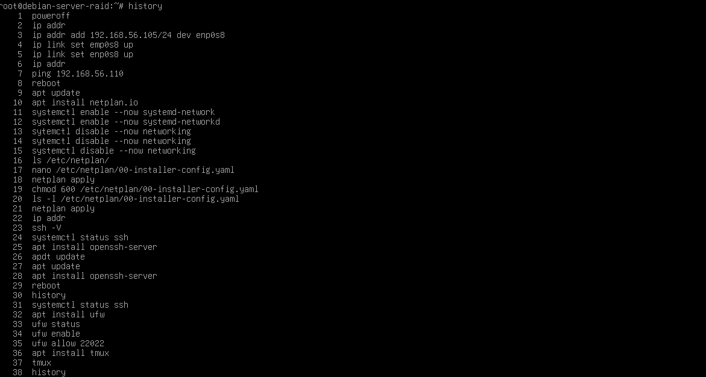
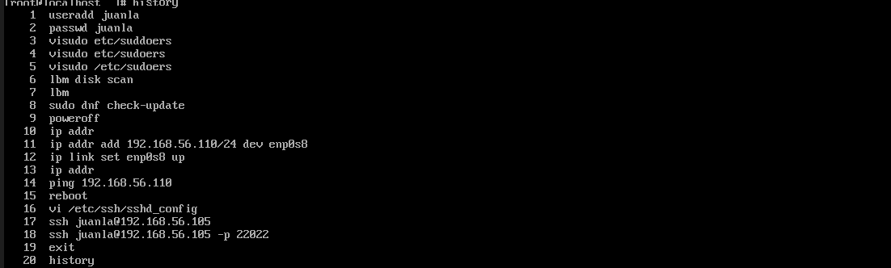
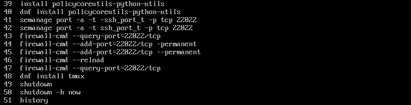

-Práctica 2-1

En esta práctica hemos realizado la configuración de red en nuestros servidores de Debian y AlmaLinux, 
hemos asignado una ip estática y levantado la interfaz, para comprobar que esto funcionaba hemos 
utilizado herramientas como ping y hemos probado a conectarnos haciendo un acceso remoto con ssh, posteriormente 
hemos configurado un cortafuegos y hemos instalado tmux para controlar distintas terminales de una manera persistente.
Aquí se puede ver lo realizado en Debian:

En AlmaLinux hemos actuado de igual:

A diferencia de en Debian aquí hemos tenido que configurar algunos detalles, 
para ello se ha instalado policecoreutils, hemos estanlecido el puerto de ssh y 
además hemos configurado el firewall.
Podemos verlo en los siguientes comandos:

